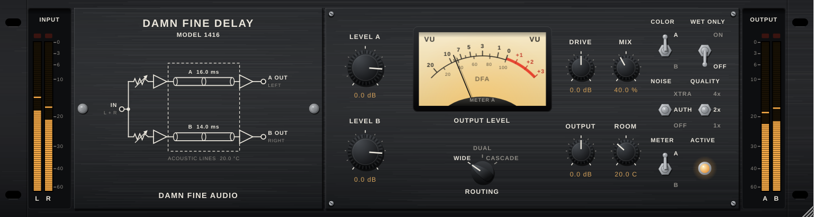

# Damn Fine Delay

A physical model of the 1971 two-line acoustic tube delay: 16 ms and 14 ms lines of coiled tubing, driven and picked up by dynamic capsules, with heavy pre- and post-EQ, and a 30 ms cascade. It is inspired by the original hardware and does not use its trademarks.

| Folder | What it is |
|---|---|
| [`plugin/`](plugin/) | Real-time C++20 engine and JUCE 8 plug-in (VST3, CLAP, Standalone; AU on macOS). v0.2. |
| [`research/`](research/) | Research notes (hardware, physics, service manual, DSP design, sources), start at [`research/00-index.md`](research/00-index.md). |
| [`research/prototype/`](research/prototype/) | Offline Python golden reference that the plug-in is null-tested against. |
| [`research/tools/`](research/tools/) | Physics model of the tube and the schematic EQ networks. |

## Quick start

```
cd plugin
cmake -S . -B build -G Ninja -DCMAKE_BUILD_TYPE=Release   # downloads JUCE 8.0.9 and clap-juce-extensions
cmake --build build                                       # also installs into your user plug-in folders
ctest --test-dir build                                    # 98 C++ spec checks
```

Reference checks (Python 3 with numpy, scipy, pytest; matplotlib and soundfile for renders):

```
cd research/prototype && PYTHONPATH=../tools python3 -m pytest -q test_engine.py
cd plugin && PYTHONPATH=../research/prototype:../research/tools python3 tests/null_test.py build/dfd_cli
```



## Licence

The code in this repository is MIT licensed (see [LICENSE](LICENSE)). JUCE itself is separately licensed: use it under the JUCE licence (the free Starter tier covers up to $20k a year of revenue) or under the AGPLv3, and pick one before distributing builds.
